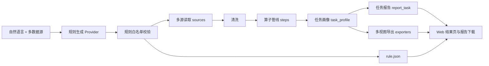

## 用户要求

在现有自然语言数据清洗管道上，把规则能力从少数固定算子扩展为覆盖常见分析/办公场景的处理工具箱，并让 HTML 报告按任务类型自适应展示，而不是固定输出与任务无关的数据画像。

## 产品概述

用户用自然语言描述需求，系统生成可查看、可编辑、可校验的规则；执行后产出可直接使用的结果表、任务报告与图表。既支持单表清洗统计，也支持多表关联（join / union）。

## 核心特性

- **占比三口径**：条件占比（如成交 7702 / 19954 = 38.6%）、分组构成占比（各小区占总量）、组内占比（组内各值占该组），并支持累计占比与帕累托。
- **常见处理场景**：多条件筛选（AND / OR、in、between、空值、包含）、去重、类型转换、缺失填充、字符串清洗 / 拆分 / 合并、日期解析与年季月聚合、分箱、条件赋值（分段打标）、排名与分组 TopN、多列多函数聚合、透视 / 交叉表、抽样、join / union。
- **任务导向结果**：按占比、排名、趋势、分布、相关、透视、明细、多表合并自动组织 KPI、图表与结果表，只展示与本任务相关的内容。
- **多数据源**：主表加最多 2 个附加表，Web 可上传文件或填写路径并指定关联键；join 结果给出匹配率与未匹配行数。
- **产物**：主结果多格式导出、附表导出、Excel 多 sheet、规则 JSON、执行摘要、任务报告 HTML。
- **兼容与降级**：旧命令行与旧报告保持不变；无 Key 时离线模板也能生成这些场景；可选依赖缺失自动降级。
- **视觉**：延续渐变蓝青加玻璃卡片的数据控制台风格。结果页顶部按任务显示 4 至 6 个 KPI，中部 2 至 3 个任务图表，下部结果表与下载区；报告页为同风格的任务单页报告。

## 技术栈

- 沿用 Python 3.12 + pandas 3.x + numpy + openpyxl，无新增运行时依赖。
- Web 继续服务端渲染 HTML + 手写 SVG，不引入前端框架、构建链与 JS。
- 多文件上传使用标准库 `email.parser` 解析 `multipart/form-data`，Flask 存在时可走 `request.files`，缺失时功能等价。

## 实现思路

采用「规则 DSL 扩展 + 任务画像 + 独立报告渲染器」三层增强，不改动旧 CLI 与旧报告内核：

1. **规则层**：`STEP_SCHEMA` 从 8 个算子扩展到约 20 个声明式算子，新增 `pct`、`pivot`、`dedupe`、`cast`、`fill`、`replace`、`split`、`concat`、`string`、`date_part`、`bin`、`assign`、`rank`、`topn`、`join`、`union`、`sample`，并增强 `filter`（多条件）、`aggregate`（多列多函数、更多聚合）、`sort`（多列升降序）。全部保持白名单、无 `eval`、无代码生成。
2. **执行层**：新增 `sources.py` 统一读取主表与附加表，`rule_executor.py` 实现新算子与三种占比；`pct` 用 `groupby.transform("sum")` 做 O(n) 归一，直接输出分子、分母、占比列，避免二次计算。
3. **任务画像**：新增 `task_profile.py`，依据「规则 steps + 结果形态」识别任务类型（占比 / 排名 / 趋势 / 分布 / 相关 / 透视 / 明细 / 多表合并），产出 KPI、图表与视图规划，不依赖对用户原话的猜测。
4. **报告层**：新增 `report_task.py` 与 `charts_svg.py`，按任务画像渲染 KPI、SVG 图表与结果表；旧 `generate_report` 保留给旧 CLI，规则链走任务报告，保护既有兼容性。
5. **Web 层**：工作台增加多数据源区、任务快捷标签与任务徽章；结果页展示任务 KPI、图表缩略与附表；新增上传落盘与安全校验。

### 关键决策与权衡

- **新增 `pct` 算子而非在报告中临时算占比**：占比是数据结果而非展示派生，落表后可导出、可继续参与排序与筛选，三口径逻辑集中在一处。
- **任务类型由规则推导而非 LLM 标注**：避免模型标注不一致；执行后已知 steps 与结果列，识别更可靠，也便于离线模板复用。
- **新旧报告并存**：旧 CLI 报告不动，规则链使用任务报告，满足「不回退既有语义」，同时避免大改 `generate_report` 引发回归。
- **多源采用 `sources` 字典 + 旧 `source` 兼容**：单表规则无需迁移，`sources` 缺省时等价于 `{"main": source}`。
- **多表安全**：每个 source 单独做路径校验，数量上限 5；join 前对齐 key 的 dtype，右表行数上限 20 万，结果行数超过主表 10 倍时中止并给出明确错误，避免笛卡尔积打爆内存。
- **性能**：`pct` 线性扫描；`pivot` 只在聚合后的小表上做；报告仅渲染聚合结果（KPI 不超过 6、图表不超过 6、表格不超过 200 行）；Web 结果表继续分页读取 CSV。

## 架构设计



组件关系：`webapp.py` 与 CLI 共用 `rules.py` / `sources.py` / `rule_executor.py` / `exporters.py`；`task_profile.py` 与 `report_task.py` 只依赖执行结果与 `charts_svg.py`，不反向依赖 Web 层。

## 目录结构

```
D:/project/dataclean/
├── rules.py                 # [MODIFY] 扩展 STEP_SCHEMA 与白名单、多条件 filter、多列 aggregate、pct/pivot/join/union 等校验、Prompt 与多源映射
├── sources.py               # [NEW] 多数据源读取、别名管理、join/union 执行、dtype 对齐、行数膨胀保护、上传文件落盘与安全校验
├── rule_executor.py         # [MODIFY] 新算子实现、三种占比、任务画像调用、多视图结果与执行摘要扩展
├── task_profile.py          # [NEW] 任务类型识别、KPI 计算、图表与视图规划（TaskProfile 数据类）
├── charts_svg.py            # [NEW] 纯 SVG 图表：环形/饼图、横向条形、帕累托、折线/面积、堆叠柱、箱线、散点、热力复用
├── report_task.py           # [NEW] 任务导向 HTML 报告：KPI 带、任务图表、结果表、附表、可折叠数据质量章节
├── exporters.py             # [MODIFY] 主表与附表导出、Excel 多 sheet、产物白名单与下载路径校验扩展
├── webapp.py                # [MODIFY] 多数据源表单与上传、任务徽章、结果页 KPI/图表/附表、报告入口
├── pages/workbench.html     # [MODIFY] 多源输入区（主表 + 2 个附加表）、任务快捷标签、任务徽章占位
├── pages/result.html        # [MODIFY] 任务 KPI 带、图表缩略区、附表切换、下载区
├── pages/report.html        # [NEW] 任务报告模板占位（服务端填充，零 JavaScript）
├── static/style.css         # [MODIFY] 多源表单、KPI 带、图表卡、附表切换、响应式样式
├── llm_provider.py          # [MODIFY] Mock 覆盖占比/排名/趋势/分布/透视/多表等场景与三口径识别
├── tests/test_scenarios.py  # [NEW] 占比三口径、透视、时间聚合、条件赋值、分箱、字符串、类型、TopN、任务报告分支
├── tests/test_multisource.py# [NEW] join/union、dtype 对齐、行数膨胀保护、上传白名单与路径安全
└── Python数据处理自动化脚本.md # [MODIFY] 能力矩阵、算子契约、多源契约、任务报告说明与示例
```

## 关键代码结构

任务画像契约（跨模块共享）：

```python
@dataclass
class TaskProfile:
    task_type: str            # proportion | ranking | trend | distribution | correlation | pivot | join | detail | summary
    title: str
    primary_dim: str          # 主分组列
    value_col: str            # 计数/金额/占比列
    kpis: List[Dict[str, Any]]      # [{label, value, hint}]
    charts: List[Dict[str, Any]]    # [{kind, title, data}]
    tables: List[Dict[str, Any]]    # [{name, frame, note}]
```

占比规则示例（三口径）：

```
{"op": "pct", "scope": "condition", "condition": {"column": "成交价(元)", "operator": "gt", "value": 0}, "alias": "成交占比"}
{"op": "pct", "scope": "overall", "by": "小区", "column": "条数", "alias": "占比", "cumulative": true}
{"op": "pct", "scope": "group", "by": "小区", "within": "户型", "column": "条数", "alias": "组内占比"}
```

多源规则示例：

```
{
  "sources": {
    "main": {"path": "lots.csv", "format": "csv"},
    "dim":  {"path": "communities.csv", "format": "csv"}
  },
  "steps": [
    {"op": "join", "right": "dim", "how": "left", "left_on": "小区", "right_on": "小区名称", "suffixes": ["", "_维表"]}
  ]
}
```

## 设计风格

延续现有「渐变蓝青 + 玻璃拟态卡片 + 数据控制台」语言，新增「任务 KPI 带」与「图表卡」两类组件。深蓝到青蓝渐变横幅、白色半透明卡片、柔和阴影、圆角与细网格背景；微交互包括卡片悬停抬升、图表入场淡入、表格行高亮、按钮悬停位移。宽屏三栏，窄屏自动堆叠；表格与 JSON 区块始终横向滚动。

## 页面一：自然语言工作台（多数据源）

- 顶部导航：品牌标识、三页切换、Provider 状态徽章，固定吸顶。
- 任务步骤条：输入需求 / 配置数据源 / 生成规则 / 校验执行，当前步高亮。
- 需求输入区：大文本框、任务快捷标签（占比、排名、趋势、分布、透视、多表合并）、示例填充。
- 数据源区：主表（路径或上传、格式）；两个可折叠附加表（别名、关联键、join 类型）；上传区显示文件名与大小，超限即时提示。
- 规则区：JSON 语法高亮、可编辑、行内校验错误、任务类型徽章、降级原因。
- 底部：各环节输入输出契约摘要与产物说明。

## 页面二：任务结果

- 顶部导航：同全局导航，附返回工作台入口与任务类型徽章。
- KPI 带：按任务显示 4 至 6 张卡（如占比任务的总体占比、Top1 占比、CR3、样本量），数值大号强调、附口径说明。
- 图表区：2 至 3 张任务图表（环形/横向条/帕累托/折线/直方图/散点/热力），卡片内嵌 SVG，悬停显示数值。
- 结果表区：主结果表分页展示，附「占比表 / 分组表 / 透视表」切换标签；数值统一格式、百分比列带进度条底纹。
- 下载区：主结果 CSV/Excel/JSON、附表、规则 JSON、执行摘要、任务报告。
- 底部：任务说明、生成时间、契约摘要。

## 页面三：任务报告

- 报告头：任务标题、意图原文、数据源与生成时间、任务类型标签。
- KPI 带与图表区：同结果页视觉，纵向单列铺开，适合打印。
- 结论区：自动生成的任务结论句（如「成交记录 7702 条，占全部 38.6%；Top3 小区合计占 12.4%」）。
- 数据表区：主结果表与附表，表头吸顶、斑马纹。
- 附录：可折叠的数据质量与清洗说明，默认收起，避免干扰任务结论。

## 一致性

三页共用顶栏、底栏、配色、字体与卡片组件；每页显著位置标注该环节输入、处理与输出；所有图表纯 SVG，报告可离线打开与打印。

## Agent Extensions

### SubAgent

- **code-explorer**
- Purpose: 在改造报告与 Web 渲染前，梳理 `generate_report` 的全部调用方、`webapp.py` 路由与模板占位符、`exporters.py` 白名单与下载校验点，确认新增任务报告与附表不会破坏旧 CLI 与既有下载链路。
- Expected outcome: 一份准确的调用点与影响面清单，确保多视图导出与报告切换只影响规则链。

### Skill

- **playwright-cli**
- Purpose: 端到端验证多数据源上传与关联、占比任务、任务结果页 KPI 与图表、任务报告下载与打开。
- Expected outcome: 真实浏览器完成「上传主表与维表 → 生成规则 → 执行 → 查看占比 KPI 与图表 → 下载报告」，并留存截图与断言结果，确认三页导航与下载路由可用。