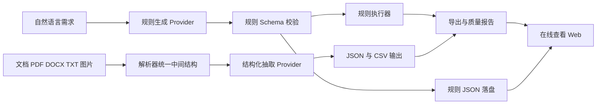

## 用户要求

在现有数据清洗管道基础上扩展两条完整链路，要求流程完整、描述清晰，并逐环节明确输入与输出。

## 产品概述

用户可用自然语言描述数据统计、清洗与整理需求，系统自动将其转换为可查看、可导出、可校验的处理规则，并由程序按规则执行整个数据处理流程，产出结果文件与在线可浏览的质量视图。另新增文档结构化抽取能力，从各类文档中自动提取结构化字段与表格，形成规范输出。原有命令行管道与静态质量报告保持可用。

## 核心特性

- 自然语言工作台：输入需求描述与数据源，生成规则并以 JSON 形式展示、可编辑、可校验、可保存
- 规则执行：按规则完成读取、清洗、统计与整理，输出处理结果、质量报告与规则文件
- 结果导出与在线查看：结果数据多格式导出；浏览器内查看规则、指标、结果表与报告，一键下载
- 文档结构化抽取：支持文本文档与图片扫描件，按可选字段定义抽取键值对与表格，输出结构化数据
- 离线可用：无凭据、无网络时自动降级为内置模板，两条链路均可完整演示
- 流程与契约说明：文档与界面均标明「自然语言输入→规则生成→规则执行」「文档抽取→结构化输出」各环节的输入、处理与产物

## 技术栈选择

- 基础沿用：Python 3.12 + pandas 3.x + numpy + openpyxl，现有 `etl_pipeline.py` 单文件管道与纯 SVG 报告
- 新增可选依赖（`requirements.txt` 分组声明，缺失时友好提示并降级）：`requests`（LLM 调用）、`pypdf` 与 `python-docx`（文档解析）、`Flask`（本地 Web 服务）
- 配置：环境变量 `LLM_BASE_URL` / `LLM_API_KEY` / `LLM_MODEL` / `LLM_VISION_MODEL`，附 `.env.example` 示例，不写入代码与日志
- Web 前端：服务端渲染内联 HTML + CSS，不引入前端构建、JS 框架或组件库，延续现有报告的渐变卡片视觉

## 实现思路

采用「薄接入层 + 规则驱动」策略：不改动既有清洗与报告内核，只在其上方增加规则层、抽取层、导出层与展示层。

1. **可插拔 Provider**：抽象 `LLMProvider` 接口（`complete` 与 `complete_vision`），实现 `OpenAICompatProvider`（chat/completions，图片以 base64 image_url 传入）与 `MockProvider`（关键词模板 + 样例视觉结果）。工厂按「显式参数 → 环境变量 → 无 Key 自动降级」选择实现，保证离线闭环。
2. **规则为一等公民**：自然语言先经 Provider 生成严格 JSON 规则，再经白名单 Schema 校验（字段类型、枚举、算子白名单、路径安全）后才允许执行；LLM 输出永不直接注入执行。规则 JSON 是唯一中间产物，可导出、可在 Web 查看与编辑。
3. **规则执行器**：把规则 `options` 映射为现有 `PipelineConfig` 字段，复用 `read_data / clean_data / transform_data / generate_report`；新增「整理/统计」步骤（列选择、重命名、筛选、排序、派生列、分组聚合）作为有序、可中断、逐步记录的操作管线，避免重造清洗轮子。
4. **文档抽取**：解析器按扩展名分派（`pypdf` / `python-docx` / 纯文本 / 图片字节），统一产出「文本内容 + 图片块」中间结构，再由 Provider 按用户可选 Schema 抽取为 JSON；表格类结果转 DataFrame 后走统一导出。
5. **兼容与降级**：`main()` 改为前缀分派，未命中新子命令时仍走原有参数与执行链（保留 `python etl_pipeline.py data.csv -f csv ...`），把改动半径压在 CLI 入口；新依赖全部沿用 `openpyxl` 的 try/except 写法。

## 关键决策与权衡

- 选前缀分派而非 argparse subparsers，可 100% 保留旧调用形式与全部旧参数定义，避免破坏文档示例与既有脚本。
- 规则采用「受限白名单 DSL」而非自由表达式或代码生成：牺牲少量灵活性，换取可校验、可审计、防注入与离线可执行。
- 结果文件统一落到 `output/` 下按时间戳分目录，Web 只读取已落盘产物并做列表缓存，避免会话内重复计算与内存堆积。
- 复杂度：清洗与统计为 O(n·m) 线性扫描，文档解析与 LLM 调用为主要瓶颈；大文件沿用 pandas 一次性载入但提供行数上限与抽样预览，Web 表格分页渲染，避免把全量 2 万行塞进 DOM。

## 实现要点（防回归）

- 复用 `LOGGER` 分级日志；严禁记录 API Key、文档全文与 LLM 完整响应，仅记录长度、耗时、模型与失败原因。
- 复用 `_fmt_num`（禁用科学计数法）、`_esc`、`_styled_table` 与横向滚动容器；数值展示口径一致。
- 不回退已修复项：热力图 NaN 灰格、统计摘要转置、清洗前缺失基线、图表智能选列、文本列专属 `Unknown` 填充、`select_dtypes(include=["object","string"])`。
- 可选依赖缺失时仅禁用对应子命令/格式并给出 pip 安装提示，原有 CSV/JSON/Excel/SQLite 管道与 HTML 报告必须照常工作。
- Windows gbk 控制台：日志不输出 emoji；HTML/JSON 一律 `encoding="utf-8"` 写盘。

## 架构设计



组件关系：`webapp.py` 与 CLI 子命令共用 `rules.py` / `rule_executor.py` / `doc_extract.py` / `exporters.py`；四者只依赖 `llm_provider.py` 与既有 `etl_pipeline.py` 的公开函数，不反向依赖 Web 层，便于后续替换 Provider 或扩展规则算子。

## 目录结构

```
D:/project/dataclean/
├── etl_pipeline.py                  # [MODIFY] 保留现有全部能力；抽出可复用的 run_pipeline(config)；main 改为子命令前缀分派，未命中时走原参数与原执行链；新增 nl/extract/web 三个入口函数。不得改动 clean_data/transform_data/generate_report 的既有语义与已修复项。
├── llm_provider.py                  # [NEW] LLMProvider 抽象接口、OpenAICompatProvider（含多模态 base64 视觉消息）、MockProvider（关键词规则模板与样例抽取结果）、工厂与超时/重试/错误归一化。全部走可选依赖 requests，缺失时仅返回 Mock。
├── rules.py                         # [NEW] 规则 JSON Schema 与 dataclass 定义、白名单校验、Prompt 组装与 LLM 输出解析修复、自然语言到规则的降级模板、options 到 PipelineConfig 的映射、整理/统计 steps 的算子白名单。
├── rule_executor.py                 # [NEW] 按规则顺序执行 read→clean→transform→steps，逐步记录阶段耗时与产物路径，调用 generate_report 生成 HTML，汇总执行摘要 Dict 供 Web 与导出复用。
├── doc_extract.py                   # [NEW] 扩展名分派解析 PDF/DOCX/TXT/图片为统一中间结构，按可选 Schema 调用 Provider（图片走 complete_vision），输出结构化 Dict 与可选 DataFrame，含来源页/字段置信度。
├── exporters.py                     # [NEW] 统一导出：结果 CSV/Excel/JSON、规则 JSON、抽取结果 JSON/CSV，文件名带时间戳，返回产物清单供在线查看与下载。
├── webapp.py                        # [NEW] Flask 应用：工作台、结果查看、文档抽取三个服务端渲染页面；规则 JSON 高亮展示、结果表分页预览、质量指标、产物下载路由；仅绑定 127.0.0.1，无前端构建。
├── requirements.txt                 # [NEW] 分组声明核心依赖与可选扩展（requests / pypdf / python-docx / Flask），注释说明各组缺失时的降级行为。
├── .env.example                     # [NEW] LLM_BASE_URL / LLM_API_KEY / LLM_MODEL / LLM_VISION_MODEL 示例，明确留空即自动降级 Mock。
├── tests/
│   └── test_offline_flow.py         # [NEW] 离线验证：Mock 生成规则、用 lots.csv 跑通执行与导出、文档抽取 TXT 与图片占位路径、CLI 旧调用形式回归断言。
└── Python数据处理自动化脚本.md      # [MODIFY] 新增两条链路的流程图与逐环节输入输出契约表（规则字段表、抽取结果字段表）、子命令与 Web 用法、依赖安装与降级说明；保留已有章节，移除或标注已过时的内嵌源码快照。
```

## 关键代码结构

规则 JSON 契约（跨模块共享，必须精确）：

```
{
  "version": "1.0",
  "intent": "原始自然语言描述",
  "source": {"path": "lots.csv", "format": "csv"},
  "options": {
    "drop_duplicates": true, "fill_missing": "median",
    "outlier_method": "iqr", "outlier_action": "clip",
    "normalize_columns": true, "drop_constant_cols": false
  },
  "steps": [
    {"op": "select", "columns": ["起拍价(元)", "成交价(元)"]},
    {"op": "filter", "column": "起拍价(元)", "operator": "gt", "value": 0},
    {"op": "sort", "by": "成交价(元)", "ascending": false}
  ],
  "output": {"formats": ["csv", "xlsx", "json"], "report": true}
}
```

Provider 接口签名（其余模块仅依赖此契约）：

```python
class LLMProvider(Protocol):
    def complete(self, system: str, user: str) -> str: ...
    def complete_vision(self, system: str, user: str,
                        images: List[Tuple[str, bytes]]) -> str: ...
```

## 设计风格

采用与现有质量报告一致的「渐变蓝青 + 卡片玻璃质感」现代数据控制台风格，服务端渲染内联 HTML + CSS，无前端框架与构建步骤。深蓝到青蓝渐变横幅、白色半透明卡片、柔和阴影、圆角、细网格背景，配 step 流程条与状态徽章；微交互包括输入聚焦光晕、按钮悬停位移、规则区折叠、表格行悬停高亮、加载骨架。响应式：宽屏三栏，窄屏自动堆叠；表格与 JSON 区块始终横向滚动，不撑破布局。

## 页面一：自然语言工作台

- 顶部导航：品牌标识、三个页面切换、当前 Provider 状态徽章（在线或离线降级），固定吸顶。
- 流程步骤条：横向四步「输入需求 / 生成规则 / 校验执行 / 导出查看」，当前步高亮，直观呈现完整链路。
- 需求输入区：大文本框、示例需求快捷标签、数据源路径与格式选择、可选的整理偏好开关。
- 规则展示区：JSON 语法高亮、可编辑、校验错误行内提示、生成来源与模型标注。
- 执行动作区：校验并执行按钮、阶段进度反馈、成功后跳转结果页。
- 底部栏：各环节输入与产物说明摘要、文档链接。

## 页面二：结果查看

- 顶部导航：同全局导航，附返回工作台入口。
- 指标卡区：行数、列数、原始缺失、异常值、质量评分环形仪表。
- 规则回看区：本次规则 JSON 折叠展示与下载按钮，标注每阶段耗时。
- 结果表预览区：分页表格、横向滚动、数值统一格式、类型标签。
- 导出区：CSV / Excel / JSON / 规则 JSON 四个下载入口，附产物清单与路径。
- 底部栏：报告链接、生成时间与文件说明。

## 页面三：文档结构化抽取

- 顶部导航：同全局导航，附抽取格式支持说明。
- 文档输入区：文件选择与拖拽、格式自动识别徽章、图片扫描件提示。
- 字段定义区：可选 Schema 的字段增删、类型与必填设置、默认模板选择。
- 抽取结果区：键值对 JSON 与表格双视图切换、字段来源与置信度标记、原文片段定位。
- 导出区：结构化 JSON / CSV 下载与「送入清洗管道」联动入口。
- 底部栏：输入输出契约摘要与格式限制说明。

## 一致性

三页共用顶栏、底栏、配色、字体与卡片组件；所有页面均在显著位置标注该环节的输入、处理与输出，满足流程完整与契约清晰的要求。

## Agent Extensions

### SubAgent

- **code-explorer**
- Purpose: 在重构 CLI 与新增模块前，梳理 `PipelineConfig` 字段引用点及 `read_data / clean_data / transform_data / generate_report / main` 的完整调用链。
- Expected outcome: 产出一份扩展点与影响面清单，确认前缀分派不会破坏既有参数、报告输出与前三轮已修复的行为。

### Skill

- **playwright-cli**
- Purpose: 验证本地 Web 在线查看链路的真实浏览器交互。
- Expected outcome: 完成「输入自然语言 → 查看规则 JSON → 预览结果表 → 一键下载」的端到端操作并留存截图与断言结果，确认三页导航与导出路由可用。