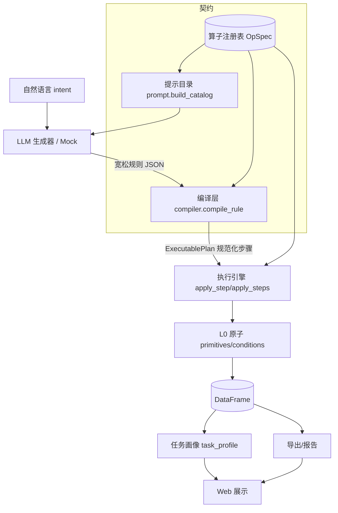

## Product Overview

将现有"扁平硬编码算子"的数据处理引擎重构为一个可生长、可组合的系统：把能力沉淀为分层操作原语，把算子变成可动态注册的声明式单元，把中间契约收敛为单一事实源，并增加"编译/降解层"，使 LLM 输出的宽松规则能被降解为程序可执行的算子组合。

## Core Features

- **分层操作原语**：底层原子（行掩码、列投影、排序、分组聚合、重塑、值变换、多表合并）向上组合为单算子与分析算子，能力可复用、可叠加。
- **动态扩展机制**：新增算子只需在一个文件内声明"名字/分层/参数/校验/引用列/新增列/执行逻辑/提示片段"并注册，核心分发查表即生效，无需改动多处 if-elif。
- **精确中间契约**：以算子声明为单一事实源，自动派生参数校验、枚举约束、可导出的 JSON 契约，以及给 LLM 的算子目录与示例。
- **编译/降解层**：把 LLM 或手工输入的宽松规则解析、列名对齐、类型归一、契约校验后编译为强类型可执行序列；非法步骤显式告警剔除，执行器只消费编译产物。
- **全量迁移**：现有全部算子（筛选、排序、去重、取值、类型转换、填充、字符串、拆分、拼接、日期分量、分箱、派生、打标、排名、聚合、占比、透视、关联、合并等）统一纳入新体系。
- **行为保持**：保留既有正确语义（复合条件占比、日期派生列命名、清洗后还原筛选/占比条件列空值、单步失败跳过、任务画像与展示）。

## Tech Stack

- Python 3 + pandas（沿用现有栈，不引入新运行时依赖）。
- `dataclasses` + `typing` 描述契约；手写轻量 JSON Schema 导出与参数校验（避免新增 `jsonschema` 依赖）。
- 现有模块作为公共入口保留：`rules.py`、`rule_executor.py`、`llm_provider.py`、`task_profile.py`、`sources.py`。

## Implementation Approach

核心思路：把"算子知识"从散落在 5–7 处的 if/elif 收敛为**单一事实源（OpSpec）**，并围绕它重建契约、执行、提示、mock 四条链路。

1. **分层**

- L0 原子（`primitives.py`）：`row_mask`（单/复合条件）、`apply_mask`、`project`、`sort_rows`、`group_agg`、`reshape_pivot`、`map_values`、`concat_columns`、`combine`（join/union 包装 `sources.py`）。
- L1 单算子：filter/sort/dedupe/head/sample/select/drop_columns/rename/cast/fill/string/split/concat/date_part/bin/derive/assign/rank，由原子组合实现。
- L2 分析算子：aggregate/pct/pivot/join/union，跨原子编排并声明输出列契约（如 pct 固定产出"分子/分母/占比"）。

2. **动态注册**

- `OpSpec` 描述一个算子；`@register_op` 装饰器写入 `_REGISTRY`；`ops/builtin/` 下按族拆分文件，`pkgutil` 自动发现导入，新增算子仅需新增一个文件。
- 注册表暴露 `get_op/all_ops/build_catalog/detect_task_type_hint`，供执行、校验、提示、画像统一调用。

3. **精确契约**

- `ParamSpec`（name/type/required/default/enum/column/multi）驱动通用校验与 JSON Schema 导出；算子可提供自定义 `validate` 钩子处理跨字段约束（如 pct 的 scope 与 condition）。
- 规则版本升级为 `2.0`；顶层仍为 `intent/sources/options/steps/output`，`steps` 由算子契约约束。

4. **编译/降解层**

- `compile_rule(dict, columns) -> ExecutablePlan`：版本与结构校验 → 参数类型规整 → 派生列别名登记（如 date_part 的 `<列>_年`）→ 列引用解析与缺列步骤剔除（合并现 `reconcile_rule_columns`/`sanitize_rule`/`_fix_step` 能力）→ 错误聚合为 `RuleValidationError`。
- 执行器 `apply_step` 改为"查注册表 → 调 `execute`"，只消费规范化步骤。

5. **LLM 降解**

- `build_rule_prompt` 从注册表生成算子目录/必填参数/示例（不再手写长提示词）；`_mock_rules` 改为注册表驱动（每个算子声明关键词与构造器）；`generate_rules` 用编译器做首次规整与降级兜底。

6. **任务画像对齐**

- `detect_task_type` 改为读取算子元数据（`task_hint`）并按优先级判定，新增算子可声明其任务类型，无需再改硬编码判断。

### 性能与可靠性

- 注册表为 dict，`O(1)` 查表；编译为对 steps 的单次线性遍历，开销可忽略。
- 保留现有保护：透视列上限、报告/表格行数截断、join 膨胀保护、单步失败 skipped 继续。
- 提示词目录构建一次并缓存，避免重复字符串拼接。
- 错误聚合（一次性返回全部校验错误）提升可诊断性；所有降级/剔除均以 warnings 审计。
- 安全边界不变：LLM 输出视为不可信，只经白名单算子与列引用校验后才执行；源路径安全校验保留。

### 避免技术债

- 不新建并行"第二套引擎"：旧公共函数名（`apply_step/apply_steps/execute_rule/generate_rules/validate_rule/probe_columns/rule_to_config`）保留为薄门面，内部委托新体系，降低对 `webapp.py` 与测试的冲击。
- 算子实现从 `rule_executor` 迁入 `ops/builtin/*`，避免双份逻辑。

## Architecture Design



## Directory Structure

```
dataclean/
├── ops/
│   ├── __init__.py                 # [NEW] 导出 register_op/get_op/all_ops/build_catalog/compile_rule 等
│   ├── registry.py                 # [NEW] OpSpec/ParamSpec 定义、注册表、@register_op、pkgutil 自动发现
│   ├── contract.py                 # [NEW] 类型/枚举/必填通用校验、JSON Schema 导出、默认值归一
│   ├── primitives.py               # [NEW] L0 原子：project/sort_rows/group_agg/reshape_pivot/map_values/combine 等
│   ├── conditions.py               # [NEW] 单/复合条件模型与掩码（迁移 _build_mask/_condition_mask/_describe_condition）
│   ├── compiler.py                 # [NEW] compile_rule：v2 归一、别名登记、列解析、错误聚合，产出 ExecutablePlan
│   ├── prompt.py                   # [NEW] 从注册表生成 LLM 算子目录/示例/必填说明
│   └── builtin/
│       ├── __init__.py             # [NEW] 触发各算子模块导入注册
│       ├── row_ops.py              # [NEW] filter/sort/dedupe/head/sample（含复合条件，声明 preserve_refs）
│       ├── col_ops.py              # [NEW] select/drop_columns/rename
│       ├── value_ops.py            # [NEW] cast/fill/string/split/concat/date_part/bin/derive/assign/rank
│       ├── agg_ops.py              # [NEW] aggregate（复用 aggregate_pairs 口径）
│       ├── pct_ops.py              # [NEW] pct（条件/构成/组内，固定产出 分子/分母/占比）
│       ├── reshape_ops.py          # [NEW] pivot（保留列上限保护）
│       └── combine_ops.py          # [NEW] join/union（包装 sources.join_frames/union_frames）
├── rules.py                        # [MODIFY] 保留公共门面；validate/normalize/_step_outputs/_step_refs 委托注册表；RULE_VERSION=2.0；删除散落 if/elif
├── rule_executor.py                # [MODIFY] apply_step/apply_steps 查注册表分发；execute_rule 接入 compiler；保留 apply_steps 日志/跳过/_filter_columns 空值还原
├── llm_provider.py                 # [MODIFY] build_rule_prompt 用 ops.prompt；_mock_rules 改为注册表驱动；保留 Provider 与降级
├── task_profile.py                 # [MODIFY] detect_task_type 改为读算子元数据（task_hint），保留各画像构建
├── webapp.py                       # [MODIFY] 流水线文案、执行计划/步骤展示对齐新算子名（改动最小）
├── sources.py                      # [KEEP] join/union 能力被 combine_ops 复用
├── etl_pipeline.py                 # [KEEP] 清洗与 PipelineConfig
├── Python数据处理自动化脚本.md       # [MODIFY] 契约章节更新为 v2 与分层/扩展说明
└── tests/
    ├── test_ops_registry.py        # [NEW] 注册/自动发现/契约导出/新增算子即插即用
    ├── test_compiler.py            # [NEW] 编译降解：别名、缺列剔除、错误聚合、v2 校验
    ├── test_scenarios.py           # [MODIFY] 算子行为按新入口与派生列命名
    ├── test_pct_compound.py        # [MODIFY] 复合占比+空值还原+别名回退经新体系
    ├── test_offline_flow.py        # [MODIFY] generate_rules 走编译器
    ├── test_multisource.py         # [MODIFY] join/union 经注册表
    ├── test_llm_config.py          # [MODIFY] 提示/降级路径
    └── test_web_multipart.py       # [KEEP] 表单解析
```

## Key Code Structures

```python
# ops/registry.py
@dataclass(frozen=True)
class ParamSpec:
    name: str
    type: Any                      # str/int/float/bool/list/dict 或其元组
    required: bool = False
    default: Any = None
    enum: tuple = ()
    column: bool = False           # 参数是列名引用，参与 refs 推导
    multi: bool = False            # 列表形态的列名

@dataclass
class OpSpec:
    name: str
    layer: int                     # 1=单算子 2=分析算子
    params: tuple                  # tuple[ParamSpec, ...]
    execute: Callable              # (df, step, ctx) -> (df, note)
    outputs: Callable = None       # (step) -> list[str] 新增列
    refs: Callable = None          # (step) -> list[str] 输入列
    validate: Callable = None      # (step, known, tag, errors) -> None
    preserve_refs: Callable = None # (step) -> list[str] 清洗后需还原空值的列
    task_hint: str = ""            # proportion/ranking/trend/distribution/pivot/join/summary/detail
    prompt_note: str = ""          # 一句话说明
    prompt_example: dict = None    # 契约示例
    mock_keywords: tuple = ()      # mock 触发关键词
    mock_build: Callable = None    # 意图上下文 -> list[dict]
```

```python
# ops/compiler.py
@dataclass
class ExecutablePlan:
    version: str
    steps: list                    # 规范化后的步骤（含 op 与已归类参数）
    columns_in: list
    columns_out: list
    warnings: list
    def to_dict(self): ...

def compile_rule(rule: dict, columns: list) -> ExecutablePlan: ...
```

## Agent Extensions

### SubAgent

- **code-explorer**
- Purpose: 在迁移前盘点每个算子在 `rules.py`、`rule_executor.py`、`llm_provider.py`、`task_profile.py`、`webapp.py`、`tests/` 的全部调用点与依赖，避免全量迁移遗漏。
- Expected outcome: 一份算子→调用点清单（文件+符号），作为迁移与回归测试覆盖的依据。

### Skill

- **lsp-code-analysis**
- Purpose: 在拆分/迁移函数时定位符号的定义、引用与实现，确保 `_apply_*`、`_step_refs/_step_outputs/_fix_step` 迁移后无悬挂引用。
- Expected outcome: 迁移后引用完整、无未定义符号，`read_lints` 与 `pytest` 全绿。