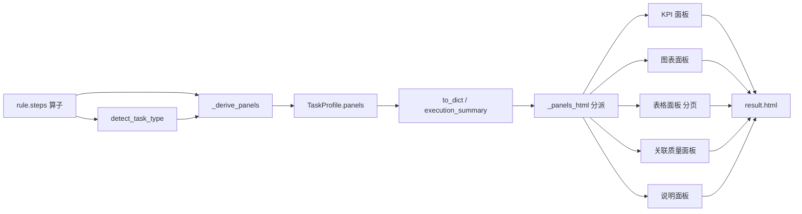

## 产品概述

结果页当前是一套固定布局套用所有任务，只把结论、KPI、图表、表格平铺。本次让展示随「实际用到的算子组合 + 任务类型」自动编排：后端输出声明式的面板规格，前端按规格按需渲染对应面板，做到算子搭配不同、界面不同、无数据不出空面板。

## 核心功能

- 面板规格输出：任务画像新增 `panels` 字段，每项声明面板类型（指标/图表/表格/关联质量/说明）、标题、提示、数据来源与图表类型过滤，随 `task` 一并输出。
- 按算子组合自动编排：按任务类型与步骤中实际出现的算子决定面板顺序与取舍（占比->指标+明细；排名->指标+条形/帕累托+排序表；趋势->指标+折线+明细；分布->指标+柱状+分箱表；透视->指标+热力+透视表；多表->关联质量+结果表；汇总/相关->指标+图+表；明细->仅明细表）。
- 前端按规格渲染：结果页改为遍历面板渲染，复用现有指标卡、图表、分页表格、关联统计与下载等能力；图表面板可按类型筛选。
- 按需与回退：缺少对应载荷的面板不渲染；面板缺失时回退为「指标+图表+表格」默认组合，保证异常画像不白屏。
- 原有区块保留：结论区、导出下载、阶段耗时、数据质量、规则回看等不改变。

## 技术栈

- 沿用现有栈：Python 标准库服务端渲染（`render()` 占位符替换）+ pandas + `charts_svg.py`，不引入前端框架或新依赖。
- 现有复用点：`task_profile.TaskProfile/to_dict`、`charts_svg.render_chart`、`webapp` 的 `_kpis_html/_charts_html/_tabs_html/_table_html/_pager_html/_artifacts_html`。

## 实现方式

1. 后端契约（加法式）：`TaskProfile` 新增 `panels: List[Dict]`；在 `build_profile` 内根据 `rule` 的算子集合（`steps[].op`）与 `task_type` 生成面板列表；`to_dict()` 增加 `panels`（不删除既有键，保持向后兼容）。
2. 面板模型：`{kind, title, hint, source, chart_kinds, count}`；`kind ∈ kpi | chart | table | join | note`；`source` 指向现有 `kpis/charts/tables/join_stats/note`。派生函数 `_derive_panels(task_type, ops)` 只做纯计算（O(#steps)）。
3. 前端渲染：`webapp` 新增 `_panels_html(task, summary, base_output, run_id, table_idx, page_no)`，按 `kind` 查表分派到既有 HTML 构造器；表格面板内部复用 `_task_table/_tabs_html/_table_html/_pager_html`，关联面板复用现有 join 统计信息；渲染时对空载荷面板跳过。
4. 模板：`pages/result.html` 用 `{{PANELS}}` 替换固定的 `{{KPIS}}/{{CHARTS}}/结果表 card`，其余区块（hero、WARNINGS、导出、STAGES、质量、规则）保持。
5. 样式：`static/style.css` 增加 `.panel/.panel-head/.panel-title/.panel-hint/.panel-body/.panel-grid/.panel-note`，沿用现有视觉规范并做响应式。

### 性能与可靠性

- 面板派生为一次线性遍历，开销可忽略；渲染复用既有分页与图表上限（图表最多 3 张、表格分页），不新增全量渲染。
- 空载荷面板直接跳过；`panels` 缺失或无有效面板时回退默认组合，避免白屏。
- 安全边界不变：沿用 `_esc` 转义与产物名 `quote`，不引入动态执行。

### 避免技术债

- 只做加法：`task_type/kpis/charts/tables/conclusion/note` 语义不变，旧摘要（无 `panels`）仍可正常展示。
- 渲染逻辑集中在 `_panels_html` 一处，新增面板类型只需增加一个分派分支与（可选）样式，符合可扩展设计。

## 架构设计



## 目录结构

```
dataclean/
├── task_profile.py            # [MODIFY] TaskProfile 增加 panels 字段与 to_dict 输出；新增 _derive_panels(task_type, ops)；
│                              #          在 build_profile 各分支按任务类型/算子组合生成面板（kpi/chart/table/join/note），
│                              #          顺序与取舍：proportion→kpi+table；ranking→kpi+chart+table；trend→kpi+chart+table；
│                              #          distribution→kpi+chart+table；pivot→kpi+chart+table；join/union→join+table；
│                              #          summary/correlation→kpi+chart+table；detail→kpi+table。不破坏既有字段语义。
├── webapp.py                  # [MODIFY] 新增 _panels_html(task, summary, base_output, run_id, table_idx, page_no)：
│                              #          遍历 task["panels"] 按 kind 分派；kpi→_kpis_html；chart→_charts_html（按 chart_kinds 过滤）；
│                              #          table→复用 _task_table/_tabs_html/_table_html/_pager_html 组合为表格面板；
│                              #          join→关联匹配率/未匹配面板；note→说明卡；空载荷跳过；无 panels 时回退默认三件套。
│                              #          结果页注入 PANELS 变量，并保留其余模板变量。
├── pages/result.html          # [MODIFY] 用 {{PANELS}} 替换固定 KPI 带、图表网格与结果表卡；保留 hero/steps/WARNINGS/
│                              #          导出下载/阶段与质量/规则回看/契约等区块，table 分页参数沿用 ?table=&page=。
├── static/style.css           # [MODIFY] 新增面板样式：.panel/.panel-head/.panel-title/.panel-hint/.panel-body/.panel-grid/
│                              #          .panel-note，与现有 .card/.kpi-band/.chart-grid 视觉一致并响应式。
└── tests/
    └── test_view_panels.py    # [NEW] 覆盖：各 task_type 的 panels 结构/顺序；to_dict 含 panels；_panels_html 在仅有部分载荷时不报错；
                               #      缺 panels 时回退默认面板；join 面板含匹配率信息。
```

## 关键代码结构

```python
# task_profile.py
@dataclass
class TaskProfile:
    # ...既有字段...
    panels: List[Dict[str, Any]] = field(default_factory=list)

def _derive_panels(task_type: str, ops: set[str]) -> List[Dict[str, Any]]: ...
# 面板项：{"kind": "kpi|chart|table|join|note", "title": str, "hint": str,
#          "source": "kpis|charts|tables|join_stats|note", "chart_kinds": list[str], "count": int}

# webapp.py
def _panels_html(task: Dict[str, Any], summary: Dict[str, Any], base_output: str,
                 run_id: str, table_idx: int, page_no: int) -> str: ...
```

## 设计风格

沿用现有「深蓝渐变 + 卡片化」的数据工作台视觉，结果页从"固定三段式"升级为"面板卡片流"：每个面板是一张独立卡片，标题区含标题、提示与轻量徽标，主体按面板类型呈现指标、图表、表格或关联质量。整体保持克制、专业、信息密度适中。

## 页面结构（结果页）

- 结论区（hero）：任务标题、结论、任务类型徽标，保持渐变背景与右侧装饰。
- 流程条：输入需求、生成规则、校验执行、导出查看四步。
- 面板流：按后端 `panels` 顺序纵向排列，宽面板（表格/关联）占整行，指标/图表类按 `panel-grid` 自适应两列（窄屏单列）。
- 保留区块：导出与下载、执行阶段与耗时、数据质量、规则回看、环节契约。

## 面板类型

- 指标面板：横向 KPI 卡带，数值大号、单位小标、提示弱化。
- 图表面板：图表卡，标题在上，SVG 居中，超出宽度自适应。
- 表格面板：标题 + 附表切换 tabs + 分页表格 + 翻页器 + 说明。
- 关联质量面板：匹配率、未匹配行数等指标 + 简短说明。
- 说明面板：浅色提示卡，承载任务备注/口径说明。

## 交互

- 面板悬停轻微上浮与阴影加深；图表卡与表格卡有统一的圆角与内边距节奏。
- 表格面板内的 tabs 与翻页沿用现有链接，不整页刷新之外的额外交互。
- 空载荷面板不出现在页面；单一面板时自动占满整行。

## 响应式

- 宽屏：指标/图表两列网格，表格与关联整行。
- 中屏：单列堆叠，KPI 卡两列换行。
- 窄屏：KPI 卡单列，表格横向滚动，翻页器自适应。

## Agent Extensions

### SubAgent

- **code-explorer**
- Purpose: 定位 `webapp` 现有渲染辅助函数与结果页注入变量的全部调用点，确保面板渲染改造不遗漏、不破坏既有表格分页与图表逻辑。
- Expected outcome: 一份渲染辅助函数与模板变量的使用清单，作为改造与测试覆盖依据。

### Skill

- **lsp-code-analysis**
- Purpose: 在改造结果页渲染分派后核对符号引用，确认 `_panels_html` 及其调用的渲染函数无悬挂引用。
- Expected outcome: 引用完整、无未定义符号，`read_lints` 与 `pytest` 全绿。