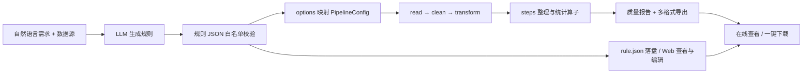
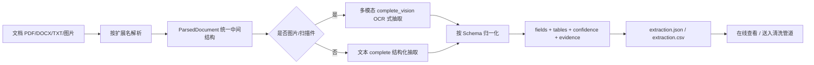

# Python 数据处理自动化脚本（全栈实现）

> 一个零额外前端依赖（仅 **Python 标准库 + pandas + openpyxl**）的 ETL 数据管道，
> 覆盖「多源读取 → 清洗 → 转换聚合 → HTML 质量报告」全链路，并支持命令行配置、
> 结构化日志与错误处理、dataclasses 配置模型。

本实现在参考样例的基础上补齐了**透视表**与**数据分布图表（纯 SVG 渲染）**两项能力，
并强化了参数校验与异常值「检测 + 处理」的闭环。

---

## 一、功能对照（相对参考实现）

| 需求 | 参考实现 | 本实现 |
| --- | --- | --- |
| 1. 多数据源读取 | CSV/JSON/Excel/SQLite | 同左，并增强：JSON 自动兼容 JSON Lines、SQLite 支持自定义 `--query`、Excel 支持指定 `--sheet` |
| 2. 清洗管道 | 去重/缺失/类型/异常值 | 同左，并增强：缺失值新增 `ffill`/`bfill`/`drop`/`zero` 且**绝不向数值列写入文本占位符**；异常值新增 `remove`/`clip` 与下/上界记录；新增**列名规范化**、**文本清洗（去空格/空串转缺失）**、**自动剔除全空列**与（可选）**剔除常数列** |
| 3. 转换与聚合 | 分组统计/重采样 | **新增透视表**（`pd.pivot_table`），重采样支持多聚合函数 |
| 4. HTML 质量报告 | 统计摘要 | 统计摘要 + **纯 SVG 直方图/取值分布/相关性热力图**（无需 matplotlib 或任何 JS） |
| 5. 命令行参数 | argparse | 全参数化，含合法值校验与 `--version` |
| 6. 日志与错误处理 | 基础 logging | 分级日志（控制台+文件）、异常分类捕获、`__post_init__` 配置自校验、顶层 `try/except` 兜底 |
| 7. dataclasses 配置 | 有 | 有，并增加参数合法性自检 |

---

## 二、整体数据流

```
输入源(CSV/JSON/Excel/SQLite)
        │
        ▼
   read_data()          多源分派读取，统一异常捕获
        │
        ▼
   clean_data()         ① 去重 ② 缺失值 ③ 类型转换 ④ 异常值检测/处理
        │                └─ 产出 clean_report 元数据
        ▼
   transform_data()     分组统计 / 透视表 / 时间序列重采样
        │                └─ 产出 transform_results
        ▼
   generate_report()    统计摘要 + SVG 图表 → 单文件 HTML
        │
        ▼
    quality_report_YYYYMMDD_HHMMSS.html
```

---

## 三、环境依赖与安装

```bash
pip install pandas openpyxl
```

约束说明：图表使用手写 SVG 字符串生成，报告不依赖任何前端绘图库或 JS，
因此核心管道「只使用 Python 标准库 + pandas + openpyxl」的约束被严格满足。

> 注：第九至十二章扩展能力引入的第三方库均为 **可选依赖**，缺失时自动降级，不影响核心约束。

---

## 四、源码结构与模块清单

> 早期版本曾在此内嵌完整源码快照。随着规则层、文档抽取层与 Web 层扩展，
> 内嵌快照已与工作区实际代码脱节，**已移除**；权威实现以工作区文件为准。

| 文件 | 职责 | 主要依赖 |
| --- | --- | --- |
| `etl_pipeline.py` | 核心管道：多源读取、清洗、转换聚合、纯 SVG 质量报告；CLI 前缀分派与 `run_pipeline()` | pandas / numpy / openpyxl |
| `llm_provider.py` | `LLMProvider` 协议、`OpenAICompatProvider`（含多模态）、`.env` 加载、工厂、无 Key 明确报错与错误归一化 | `requests`（可选）/ 标准库 `urllib` |
| `rules.py` | 规则 JSON 契约、54 个算子（以注册表为准）的 `STEP_SCHEMA` 白名单校验（列推导与校验委托注册表）、Prompt 组装、`options → PipelineConfig` 映射 | 核心 + Provider |
| `rule_executor.py` | `read → clean → transform → steps → 任务画像 → 报告/导出`，阶段耗时、跳过步骤与执行摘要 | 核心 + rules + sources + task_profile |
| `sources.py` | 多数据源读取、join/union、键对齐、膨胀保护、上传落盘与安全校验 | 核心 + rules |
| `task_profile.py` | 任务类型识别（9 类）与 KPI / 图表 / 表格规划（`TaskProfile`） | 核心 |
| `charts_svg.py` | 纯 SVG 图表：环形、横向条、帕累托、折线、柱状、散点、热力 | 核心 |
| `report_task.py` | 任务导向单页 HTML 报告（内联样式 + SVG，可离线打印），章节编排委托展示模板引擎 | display_templates + charts_svg + task_profile |
| `display_templates.py` | 场景化展示模板引擎：12 类典型场景 → 展示方式映射、目标/规模/字段驱动的块选择、可注册块渲染器 | 核心 + charts_svg + formatting |
| `display_showcase.py` | 展示样例生成器：真实数据 + 画像，产出演示/汇报/使用说明三类 HTML 与场景总览页 | display_templates + task_profile |
| `doc_extract.py` | PDF/DOCX/TXT/图片解析 → 统一中间结构 → 结构化抽取 | pypdf / python-docx（可选） |
| `exporters.py` | 结果 CSV/Excel（多 sheet）/JSON、附表 `table_N.csv`、规则 JSON、抽取结果、执行摘要、下载路径安全 | 核心 |
| `webapp.py` | 本地 Web 三页工作台 + 多数据源上传（Flask，缺失时降级标准库 `http.server`） | Flask（可选） |
| `pages/*.html` + `static/style.css` | 服务端渲染页面模板与样式，**零 JavaScript** | — |
| `tests/test_offline_flow.py` | 离线端到端回归测试（旧链路） | pytest |
| `tests/test_scenarios.py` / `tests/test_multisource.py` | 新增算子、任务画像、多源与上传安全测试 | pytest |
| `requirements.txt` / `.env.example` | 依赖分组与 LLM 环境变量示例 | — |

**分层原则**：`webapp.py` 与 CLI 子命令共用 `rules.py` / `rule_executor.py` /
`doc_extract.py` / `exporters.py`；四者只依赖 `llm_provider.py` 与既有
`etl_pipeline.py` 的公开函数，不反向依赖 Web 层，便于替换 Provider 或扩展规则算子。

---

## 五、命令行参数说明

| 参数 | 说明 | 默认值 |
| --- | --- | --- |
| `input` | 输入文件路径（位置参数） | 必填 |
| `-f/--format` | 输入格式：`csv`/`json`/`excel`/`sqlite` | 必填 |
| `-o/--output` | 报告输出目录 | `./output` |
| `--table` | SQLite 表名（未指定 `--query` 时） | `data` |
| `--query` | SQLite 自定义 SQL（覆盖 `--table`） | 无 |
| `--sheet` | Excel 工作表名/索引 | 第一个 sheet |
| `--no-dedup` | 跳过去重 | 否 |
| `--fill` | 缺失值策略：`median`/`mean`/`mode`/`drop`/`zero`/`ffill`/`bfill` | `median` |
| `--outlier` | 异常值检测：`iqr`/`zscore`/`none` | `iqr` |
| `--outlier-action` | 异常值处理：`report`/`remove`/`clip` | `report` |
| `--outlier-threshold` | 异常值阈值（系数） | `1.5` |
| `--group-by` | 分组统计列 | 无 |
| `--agg` | 分组聚合函数（逗号分隔） | `count,mean,sum,min,max` |
| `--pivot-index/--pivot-columns/--pivot-values` | 透视表三要素 | 无 |
| `--pivot-agg` | 透视表聚合函数 | `mean` |
| `--time-col` | 时间序列列名 | 无 |
| `--resample` | 重采样频率：`D`/`W`/`M`/`Q`/`Y`/`H`… | 无 |
| `--resample-agg` | 重采样聚合函数 | `mean,sum,count` |
| `--encoding` | 文本编码 | `utf-8` |
| `--log-level` | 日志级别 | `INFO` |
| `--log-file` | 日志文件路径 | 仅控制台 |
| `--max-charts` | 报告最多渲染图表数 | `6` |
| `--no-normalize-cols` | 关闭列名规范化（去空格/折叠空白/去重名） | 默认开启 |
| `--no-clean-text` | 关闭文本列清洗（去空格/空串转缺失） | 默认开启 |
| `--no-drop-empty` | 关闭自动剔除全空列 | 默认开启 |
| `--drop-constant` | 开启自动剔除零方差（常量）列 | 默认关闭 |
| `--version` | 打印版本号 | — |

---

## 六、使用示例

```bash
# 1) CSV：按 category 分组统计
python etl_pipeline.py data.csv -f csv --group-by category

# 2) Excel：均值填充，按日期列做月度重采样
python etl_pipeline.py sales.xlsx -f excel --fill mean --time-col date --resample M

# 3) SQLite：自定义查询 + Z-Score 异常值并裁剪
python etl_pipeline.py app.db -f sqlite --query "SELECT * FROM users" --outlier zscore --outlier-action clip

# 4) JSON：生成透视表 + 写入日志文件
python etl_pipeline.py events.json -f json \
  --pivot-index region --pivot-columns channel --pivot-values amount \
  --log-file run.log

# 5) 仅检测不处理异常值，关闭去重，输出 3 张图
python etl_pipeline.py data.csv -f csv --no-dedup --outlier-action report --max-charts 3
```

---

## 七、输出报告结构

生成的 `quality_report_*.html` 包含：

- **指标卡片**：总行数 / 总列数 / 原始缺失 / 重复行 / 异常值 / 剔除列（均基于清洗前基线）
- **列类型表**：每列推断后的 dtype
- **统计摘要**：`df.describe(include="all")` **按列转置**（行＝原始列、列＝统计量），宽表包裹横向滚动容器，列多时不再无限撑开页面
- **各列缺失值**：**清洗前基线**的逐列缺失数量 + 缺失率(%)，并提示被自动剔除的低信息列
- **异常值明细**：每列下界/上界/处理动作（IQR 或 Z-Score）
- **数据分布图表**：数值列直方图 + 类别列取值条形图 + 数值列相关性热力图（均为内联 SVG）。图表按**信息量智能选列**——自动跳过近似唯一的 ID 类列与零方差列，使真正有分布意义（含大额数值）的列优先出图，避免被顺序靠前的大宽表列挤掉；热力图与宽表均包裹横向滚动容器
- **转换结果**：分组统计表 / 透视表 / 重采样表（按调用参数条件出现）

---

## 八、扩展建议

1. **增量/调度**：配合 cron 或系统定时任务周期性运行，报告按时间戳落盘，天然支持历史对比。
2. **单元测试**：对 `clean_data`/`transform_data` 用 `pytest` + 小样本 DataFrame 做断言。
3. **配置持久化**：将 `PipelineConfig` 序列化为 YAML/JSON，`__post_init__` 已具备校验能力。
4. **可观测性**：`clean_report` / `transform_results` 可二次导出为机器可读的 JSON 摘要。
5. **性能**：超大数据集可改为 `pd.read_csv(chunksize=...)` 分块流式清洗。

---

*由 etl_pipeline.py 自动生成思路整理而成，脚本本身零额外前端依赖。*

---

## 九、扩展链路一：自然语言输入 → 规则生成 → 规则执行

### 9.1 完整流程



### 9.2 逐环节输入与输出契约

| 环节 | 输入 | 处理 | 输出（可落盘 / 可查看） |
| --- | --- | --- | --- |
| ① 自然语言输入 | `intent`（需求描述）、`source.path`、`source.format`、`columns`（可选，留空自动探测） | 组装结构化 Prompt（含列名清单、算子白名单、格式白名单） | 结构化 Prompt（system + user JSON） |
| ② 规则生成 | Prompt + LLM Provider | OpenAI 兼容 `chat/completions`（HTTP 优先 `requests`，缺失时标准库 `urllib`）；无 Key 或调用失败时不再猜测意图，而是给出明确错误提示；离线执行请用显式规则 JSON（`--rule-file` / 工作台规则 JSON） | **规则 JSON**（唯一中间产物）+ Provider 元信息（来源、模型、耗时） |
| ③ 规则校验 | 规则 JSON | 版本、字段类型、枚举白名单、`steps` 算子与列引用白名单、`source.path` 路径安全；臆造列自动剔除并记录警告 | 通过校验的规则；或行内校验错误列表 |
| ④ 规则执行 | 校验后的规则 | `options` 映射为 `PipelineConfig` 并复用既有 `read_data / clean_data / transform_data / generate_report`；`steps` 顺序执行受限算子 | 处理后 DataFrame、阶段耗时、`clean_report`、`transform_results` |
| ⑤ 导出与查看 | DataFrame + 规则 + 摘要 | 统一导出器 + 静态 HTML 报告 + Web 结果页分页读取 | `result.csv/xlsx/json`、`rule.json`、`execution_summary.json`、`quality_report_*.html` |

### 9.3 规则 JSON 契约（version 2.0）

```json
{
  "version": "2.0",
  "intent": "按区域分组统计，均值填充缺失，剔除常数列，导出 excel",
  "source": {"path": "lots.csv", "format": "csv"},
  "options": {
    "drop_duplicates": true,
    "fill_missing": "median",
    "outlier_method": "iqr",
    "outlier_action": "clip",
    "outlier_threshold": 1.5,
    "normalize_columns": true,
    "clean_text": true,
    "drop_empty_cols": true,
    "drop_constant_cols": false,
    "max_charts": 6,
    "group_by": null,
    "agg_funcs": ["count", "mean", "sum", "min", "max"]
  },
  "steps": [
    {"op": "select", "columns": ["起拍价(元)", "成交价(元)"]},
    {"op": "filter", "column": "起拍价(元)", "operator": "gt", "value": 0},
    {"op": "sort", "by": "成交价(元)", "ascending": false}
  ],
  "output": {"formats": ["csv", "xlsx", "json"], "report": true}
}
```

| 规则块 | 字段 | 允许值 / 约束 |
| --- | --- | --- |
| `source` | `path` | 本地已存在的普通文件；拒绝 URL、`\x00`、目录穿越 |
| `source` | `format` | `csv` / `json` / `excel` / `sqlite` |
| `options` | `fill_missing` | `median` `mean` `mode` `drop` `zero` `ffill` `bfill` |
| `options` | `outlier_method` / `outlier_action` | `iqr` `zscore` `none` / `report` `remove` `clip` |
| `options` | 布尔项 | `drop_duplicates` `normalize_columns` `clean_text` `drop_empty_cols` `drop_constant_cols` |
| `steps[].op` | 受限算子白名单（54 个，以 `ops.registry` 实际注册为准；完整清单见 `ops/registry` 与 `ops/builtin`） | 行：`filter` `sort` `head` `tail` `sample` `dedupe` `dropna`；列：`select` `drop_columns` `rename`；值：`cast` `fill` `replace` `string` `split` `concat` `date_part` `date_diff` `bin` `derive` `assign` `rank`；数值：`clip` `normalize` `outlier` `cumsum` `describe`；分析：`aggregate` `pct` `pivot` `melt`；多表：`join` `union` |
| `column_aliases` | 列名映射（可选，顶层） | `{"地区": "city"}`；也接受 `地区=city` 多行文本。值必须是真实列，不合法项忽略并提示；未提供映射时程序不做任何语义猜测 |
| `steps[]` | 列引用 | 必须来自数据源真实列；不合法项自动剔除并给出可审计警告 |
| `filter.operator` | 比较算子 | `eq` `ne` `gt` `gte` `lt` `lte` `contains` `not_contains` `startswith` `endswith` `regex` `in` `not_in` `between` `notna` `isna` |
| `derive.operator` | 四则运算 | `add` `sub` `mul` `div`（向量运算，不使用 `eval`） |
| `output` | `formats` / `report` | `csv` `xlsx` `json` / 是否生成 HTML 质量报告 |

**安全边界**：LLM 输出仅作为不可信文本解析，绝不直接执行；`source` 与 `intent`
一律以调用方输入覆盖；规则采用受限白名单 DSL 而非自由表达式 / 代码生成，
换取可校验、可审计、防注入与离线可执行。

### 9.4 分组统计类需求（示例与保护）

以「我想把成交的数据（成交价不为零）按小区分组，统计每个小区有几条成交数据」为例：

| 环节 | 输入 | 处理 | 输出 |
| --- | --- | --- | --- |
| 规则生成 | 自然语言 + 数据源列清单 | 「不为零」→ `filter gt 0`；「按 X 分组 + 几条/条数」→ `aggregate func=count` | 规则 JSON（`steps` 有序） |
| 读取 | `lots.csv` | 19954 行；备份 `filter` 引用的列 | 原始 DataFrame |
| 清洗 | 规则 `options` | 若行数骤降超 90%（如 `fill_missing=drop`），自动改用不删行配置重跑 | 清洗后 DataFrame + `safety_warnings` |
| 过滤 | 原始成交价值 | 还原备份列后再判断，避免缺失填充把「未成交」变成非零 | 7702 条成交记录 |
| 聚合 | 小区分组 | `groupby(小区).count()`，结果列命名「条数」（可用 `alias` 覆盖） | 2174 行 × 2 列汇总表 |
| 导出与报告 | 汇总表 | 多格式导出 + 规则 + 执行摘要 + HTML | 结果表可直接下载；HTML 含「处理结果」预览 |

保护要点：

- **过滤基于原始值**：清洗的缺失填充发生在过滤之前，若直接判断会把 12252 个
  缺失成交价填成中位数后误判为「已成交」；执行器在清洗后按索引还原过滤列。
- **空结果防呆**：缺失密集数据集上 `fill_missing="drop"` 会删光所有行，
  现已自动回退为 `median` + `outlier_action=report`，原因写入执行摘要。
- **HTML 体积上限**：分组统计附加表最多 200 行 / 12 列，处理结果预览最多
  100 行 / 20 列；`steps` 已产出聚合结果时不再重复渲染庞大分组表。
  该样例报告从 8 MB 降到约 20–25 KB。
- **可读列名**：`func="count"` 的结果列默认叫「条数」，避免计数被误读为原始价格。
- 显式规则 JSON 与在线模型均可生成这组 `steps`；在线输出若含臆造列名或非法枚举，
  先经 `sanitize_rule()` 白名单规整并给出 `reconcile_warnings`。

回归测试见 `tests/test_offline_flow.py` 的
`test_group_count_intent_offline_flow` /
`test_drop_fill_safety_and_filter_column_protection` /
`test_report_grouped_table_is_bounded`。

### 9.5 处理工具箱：算子能力矩阵

`steps` 从 8 个算子扩展到 54 个声明式算子（以 `ops.registry` 实际注册为准），全部在白名单内实现（无 `eval`、无代码生成）。
每个算子在注册表里声明参数、输入列、产出列与示例，执行、校验、编译与提示词目录共用同一份定义。

| 场景 | 算子 | 关键参数 | 产出 |
| --- | --- | --- | --- |
| 选列 / 删列 / 改名 | `select` / `drop_columns` / `rename` | `columns` / `mapping` | 列子集 |
| 多条件筛选 | `filter` | `conditions[] + logic`（and/or）；单条件用 `column/operator/value` | 行子集 |
| 排序 | `sort` | `by` 可为列表，`ascending` 可为列表 | 有序表 |
| 派生计算 | `derive` | `operator=add/sub/mul/div/ratio/round`，`right` 可列可常量 | 新数值列 |
| 多列多函数聚合 | `aggregate` | `by`、`column`、`func`（列表按列×函数展开）、`alias` | 汇总表 |
| 占比三口径 | `pct` | `scope=condition/overall/group`、`cumulative` | 分子 / 分母 / 占比 |
| 透视交叉表 | `pivot` | `index`、`columns`、`values`、`aggfunc` | 宽表（列数上限 36） |
| 去重 | `dedupe` | `subset`、`keep` | 去重后表 |
| 类型转换 | `cast` | `to=int/float/str/datetime/category/bool` | 类型已转换 |
| 缺失填充 | `fill` | `method=value/mean/median/mode/zero/ffill/bfill/drop` | 填充后表 |
| 文本清洗 | `string` | `action=strip/lower/upper/title/replace/regex_extract/slice/pad/cat` | 新文本列 |
| 文本拆分 / 合并 | `split` / `concat` | `sep`、`into` | 多列 / 单列 |
| 日期分量 | `date_part` | `parts=year/quarter/month/week/day/weekday/hour` | 年/季度/月/周/日/星期/小时 |
| 数值分箱 | `bin` | `bins`（数量或边界数组）、`method=width/quantile` | 有序分类列 |
| 分段打标 | `assign` | `rules[{condition,value}] + default` | 标签列 |
| 排名 / 组内 TopN | `rank` | `by`、`group_by`、`method`、`topn` | 排名列（可过滤 TopN） |
| 抽样 | `sample` | `n` / `frac`、`random_state` | 样本表 |
| 取尾部 | `tail` | `n` | 后 N 行 |
| 删除缺失行 | `dropna` | `subset`、`how=any/all`、`thresh` | 行子集（未给 `subset` 时还原全部列原始空值） |
| 取值替换 / 口径统一 | `replace` | `columns` + `mapping`，或 `column` + `value/replacement` | 替换后的列 |
| 数值截断 | `clip` | `column`、`lower`、`upper` | 截断后的列 |
| 标准化 | `normalize` | `method=minmax/zscore/rank_pct`、`into` | 新数值列 |
| 异常值处理 | `outlier` | `method=iqr/zscore`、`action=flag/clip/remove`、`threshold` | 标记列 / 裁剪 / 删行 |
| 日期差 / 时长 | `date_diff` | `left`、`right`、`unit=day/hour/minute/month/year` | 时长列 |
| 累计 | `cumsum` | `column`、`by`（可选分组） | 累计列 |
| 宽表转长表 | `melt` | `id_vars`、`value_vars`、`var_name`、`value_name` | 长表 |
| 统计概览 | `describe` | `columns`（缺省全部数值列） | 非空数 / 均值 / 标准差 / 最值 |
| 多表关联 | `join` | `right`（别名）、`how`、`left_on`、`right_on`、`suffixes` | 关联后宽表 + 统计 |
| 纵向合并 | `union` | `right`（别名） | 同名列纵向拼接 |

约定：

- **列推导链式校验**：`derive/bin/assign/rank/concat/date_part/split/pct/aggregate`
  会登记新增列，后续步骤可以直接引用（`reconcile_rule_columns` 与校验器同步）。
- **单步失败不中断**：任一步异常记为 `status=skipped` 并写入 `step_logs`，
  其余步骤继续执行，页面与报告会标注跳过原因。
- **计数口径**：`aggregate func=count` 使用分组行数（group size），结果列默认「条数」。

### 9.6 占比三口径契约

```json
{"op": "pct", "scope": "condition", "condition": {"column": "成交价(元)", "operator": "gt", "value": 0}, "alias": "成交占比"}
{"op": "pct", "scope": "overall", "by": "小区", "column": "条数", "alias": "占比", "cumulative": true}
{"op": "pct", "scope": "group", "by": "小区", "within": "户型", "column": "条数", "alias": "组内占比"}
```

| 口径 | 分母 | 输出形态 | 典型问题 |
| --- | --- | --- | --- |
| `condition` | 全部行数 | **单行**汇总：条件 / 分子 / 分母 / 占比 | 「成交占比是多少」（7702 / 19954 = 38.6%） |
| `overall` | 全量合计 | 原表追加 分子 / 分母 / 占比 列 | 「各小区成交套数占全部多少」 |
| `group` | 所在 `by` 分组合计 | 原表追加 组内占比 列 | 「各户型占该小区多少」 |

`cumulative=true` 按占比降序累计，用于帕累托（TopN 集中度）分析。占比以百分数
（0–100）落表，可直接导出、排序与再筛选。

### 9.7 多数据源契约

```json
{
  "version": "2.0",
  "intent": "按小区关联维表后统计成交套数",
  "sources": {
    "main": {"path": "lots.csv", "format": "csv"},
    "dim":  {"path": "communities.csv", "format": "csv"}
  },
  "steps": [
    {"op": "join", "right": "dim", "how": "left",
     "left_on": "小区", "right_on": "小区名称", "suffixes": ["", "_维表"]}
  ],
  "output": {"formats": ["csv", "xlsx"], "report": true}
}
```

- **兼容**：单表规则无需迁移，`sources` 缺省时等价于 `{"main": source}`。
- **数量上限**：最多 5 个数据源（主表 + 4 附表），Web 表单提供 2 个附加表位。
- **键对齐**：关联键统一转字符串并 `strip`，`1001` / `"1001"` / `" 1001 "` 视为同一键。
- **膨胀保护**：右表超过 20 万行直接拒绝；右表键重复度超过 10 倍、或关联结果超过
  主表 10 倍时中止并给出明确错误，避免笛卡尔积打爆内存。
- **统计回传**：每次关联记录 `matched / unmatched_left / unmatched_right / match_rate`，
  写入执行摘要的 `task.join`，结果页与报告展示匹配率与未匹配行数。
- **上传落盘**：Web 上传仅允许 `.csv/.tsv/.txt/.json/.xlsx/.xls/.db/.sqlite`，
  单文件 ≤ 20MB，文件名清洗 + 随机前缀，落盘路径限制在 `uploads/` 内。

### 9.8 任务画像与任务报告

任务类型由「规则 steps + 结果形态」推导（不猜测用户原话），共 9 类：
`proportion / ranking / trend / distribution / correlation / pivot / join / summary / detail`。

| 任务类型 | KPI 示例 | 图表 |
| --- | --- | --- |
| 占比 | 总体占比、Top1 占比、CR3、合计 | 环形图、帕累托 / 横向条 |
| 排名 | Top1、前 3 合计、参与排名数 | 横向条 Top10 |
| 趋势 | 期数、峰值期、末期环比、累计 | 折线 + 面积 |
| 分布 | 区间数、众数区间、样本量 | 纵向柱状（按分箱顺序） |
| 透视 | 行维度数、列维度数、最大单元格 | 热力图 |
| 多表合并 | 关联方式、匹配率、未匹配、结果行数 | 环形图 + 分布条 |
| 汇总 / 明细 | 分组数、合计/均值、行数、缺失率 | 横向条 / 分类计数 |

产物：

- `result.csv / result.xlsx / result.json`：主结果；Excel 同时写入附表 sheet。
- `table_1.csv … table_6.csv`：附表（维度汇总、关联统计）。
- `rule.json`、`execution_summary.json`（含 `task` 画像，JSON 可序列化）。
- `task_report_YYYYMMDD_HHMMSS.html`：任务单页报告（自包含 SVG + 内联样式，可离线打开与打印）。
- `quality_report_*.html`：旧的质量视角报告保持生成，兼容既有使用方式。

---

### 9.10 场景化展示模板系统（数据处理场景 ↔ 展示方式）

报告层由 `display_templates.py` 统一驱动：把「数据处理场景」与「展示方式」解耦，
同一份结果可按需切换展示模板，并保留原有生成能力。

**典型场景 → 推荐展示方式**（`SCENARIO_CATALOG` 为单一事实源）：

| 场景 | 卡片 | 图表 | 表格 | 摘要/附录 |
| --- | --- | --- | --- | --- |
| 数据清洗 | 清洗规模 | 条形 | 处置明细 | 质量基线 + 步骤 |
| 统计分析 | 核心指标 | 直方图/分布 | 统计摘要 | 口径说明 |
| 分组汇总 | 头部分组 | 条形/环形 | 分组结果 | 口径说明 |
| 趋势对比 | 峰值/环比 | 折线 | 逐期明细 | 均价口径 |
| 异常识别 | 异常规模 | 柱状（可选） | 异常明细 | 检测边界附录 |
| 占比构成 | 比率/分子分母 | 环形/帕累托 | 占比明细 | 口径说明 |
| 排名分析 | 冠军/CR3 | 横向条 | 排名明细 | 口径说明 |
| 分布分析 | 主区间 | 柱状 | 区间计数 | 口径说明 |
| 相关分析 | 相关系数 | 散点/热力 | 系数明细 | 口径说明 |
| 透视分析 | 交叉规模 | 热力图 | 透视原表 | 口径说明 |
| 多表合并 | 匹配率 | 环形/分布条 | 合并结果 | 关联质量 |
| 明细查看 | 结果规模 | 不渲染 | 逐行明细 | 口径说明 |

**模板选择四维依据**：

1. **数据类型**：数值字段 → 直方图/散点；类别字段 → 条形/环形；时间字段 → 折线。
2. **字段特征**：低基数字段适合构成图，高基数 ID 类字段跳过图表只入表格。
3. **结果规模**：小（≤50 行）保留完整明细；大（>500 行）收紧表格行数、图表只用聚合后小数据。
4. **展示目标**：`demo` 演示突出卡片图表、`report` 汇报补齐结论附录、`guide` 使用说明追加算子链路与选择理由。

**扩展方式**：新增展示形态只需 `@dt.register_block(kind)` 注册渲染函数；新增场景只需在
`SCENARIO_CATALOG` 增加一条 `ScenarioSpec`。`render_sections(..., goal/template/blocks)`
支持显式配置模板覆盖自动选择。

**演示产物**：`python etl_pipeline.py showcase --output-dir output/showcase` 生成
`index.html` 场景总览页 + 11 类场景 × 3 种目标的 33 个自包含 HTML，可直接用于演示、汇报与使用说明。

---

### 9.11 可生长算子体系（分层 + 注册 + 契约 + 编译，version 2.0）

算子能力从"散落在多处 if-elif 的扁平实现"升级为可生长、可组合的系统，核心是**单一事实源**（`ops/registry.py` 的 `OpSpec`）：每个算子只声明一次（参数、引用列、新增列、清洗保护列、校验钩子、执行函数、任务类型提示、提示词示例），校验、编译、执行、提示词、任务画像全部从注册表读取。

分层结构：

| 层 | 位置 | 职责 |
| --- | --- | --- |
| L0 原语 | `ops/primitives.py`、`ops/conditions.py` | 数值化、列解析、聚合包装、单/复合条件掩码、条件描述 |
| L1 单算子 | `ops/builtin/row_ops.py`、`col_ops.py`、`value_ops.py` | filter/sort/head/sample/dedupe、select/drop/rename、cast/fill/string/split/concat/date_part/bin/derive/assign/rank |
| L2 分析算子 | `ops/builtin/agg_ops.py`、`pct_ops.py`、`reshape_ops.py`、`combine_ops.py` | aggregate、pct（条件/构成/组内）、pivot、join/union |

四条链路：

- **契约**（`ops/contract.py`）：由 `ParamSpec` 派生字段/类型/枚举/列引用校验，并可导出 JSON Schema；跨字段约束由算子自定义 `validate` 钩子处理，错误一次性聚合。
- **编译/降解**（`ops/compiler.py`）：`compile_rule(rule, columns) → ExecutablePlan`，完成 v2 结构规整、`date_part` 派生列短标签别名回退（`年 → <列>_年`）、缺列步骤剔除（带 warnings）、契约校验；执行器只消费编译产物，LLM 输出始终视为不可信输入。
- **提示词**（`ops/prompt.py`）：从注册表自动生成算子目录，`build_rule_prompt` 将其拼入系统消息，保证"LLM 可用算子"与"程序可执行算子"一致。
- **任务画像**（`task_profile.detect_task_type`）：显式优先级 + 算子 `task_hint` 通用回退，新增算子声明类型即可参与判定。

扩展一个算子的最小步骤（无需改动核心分发）：

```python
# ops/builtin/my_ops.py
from ops.registry import OpSpec, ParamSpec, register_op

def apply_xxx(df, step, frames=None, ctx=None):
    ...
    return df, "说明"

register_op(OpSpec(
    name="xxx", layer=1, execute=apply_xxx,
    params=(ParamSpec("column", str, required=True, column=True),),
    outputs=lambda s: ["xxx_out"], task_hint="summary",
    summary="一句话说明", prompt_example={"op": "xxx", "column": "<列>"},
))
```

再在 `ops/builtin/__init__.py` 追加导入即可全局生效（校验、编译、执行、提示、画像自动接入）。规则契约版本同步升级为 `2.0`。

### 9.9 列名映射（描述用中文，列名用英文）

需求里用中文描述字段、数据列名是英文（或两边不同名）时，由使用者显式给出映射。
程序**不内置任何语义词典**，也不会把「地区」自动猜成「市」「省」或「小区」：

```json
{
  "intent": "筛选地区是福州，结束时间在2026年，小区不为空的数据，然后按小区分组，统计每个小区有几条数据",
  "column_aliases": {"地区": "city", "结束时间": "end_time", "小区": "community"}
}
```

Web 工作台在「需求输入」区提供同名字段：每行一条 `描述 = 列名`（也接受 `：` / `:` / `tab` / `=>`，
`#` 开头为注释），页面同时列出已探测的真实列名，便于对照填写。

约定：

- 命中映射时，规则里所有列引用都使用映射右侧的真实列名；
- 映射值必须是真实列，否则忽略并在生成结果上方提示；
- 描述词既没有映射、也没有同名列时，不会落到某个相近列上，而是提示
  「需求中的「X」未匹配到同名列，请在列名映射中指定对应列」；
- 生成的规则顶层保留 `column_aliases`，结果页与 `rule.json` 可追溯口径。

---

## 十、扩展链路二：文档抽取 → 结构化输出

### 10.1 完整流程



### 10.2 逐环节输入与输出契约

| 环节 | 输入 | 处理 | 输出 |
| --- | --- | --- | --- |
| ① 文档输入 | 本地文档路径 + 可选字段定义 Schema（`*名称:类型`，`*` 为必填） | 扩展名白名单校验、文件大小与编码识别 | 待解析文档 + Schema |
| ② 解析 | 文档字节 | `pypdf` / `python-docx` / 纯文本读取 / 图片字节；可选依赖缺失时给出 pip 安装提示并允许改用其它格式 | `ParsedDocument{text, pages, images, meta}` |
| ③ 抽取 | 统一中间结构 + Schema | 文本走 `complete`；图片走 `complete_vision`（base64 `image_url`）；无凭据或调用失败时明确报错并提示配置 `LLM_API_KEY`，不再降级到占位模板 | 原始 JSON（fields / tables / confidence / evidence） |
| ④ 归一化 | 原始 JSON | Schema 字段过滤、表格列宽对齐、证据片段截断、置信度类型收敛 | **结构化结果 Dict** |
| ⑤ 导出 | 结构化结果 | JSON 全量 + 首个表格（或字段键值对）转 CSV；产物落到时间戳运行目录 | `extraction.json` / `extraction.csv` + Web 双视图（JSON / 表格） |

### 10.3 结构化输出契约

| 字段 | 类型 | 说明 |
| --- | --- | --- |
| `version` | string | 固定 `2.0` |
| `source` | object | `path` / `format` / `pages` / `chars`；图片字节数与视觉调用信息见执行元信息 `meta` |
| `schema` | array | 本次使用的字段定义 `[{name, type, required}]` |
| `fields` | object | 字段名 → 抽取值；Schema 之外的字段被忽略并记录警告 |
| `tables` | array | `[{name, columns, rows, source}]`，`rows` 为对齐列宽后的二维数组 |
| `confidence` | object | 字段名 → 0~1 置信度 |
| `evidence` | array | `[{field, snippet, page}]`，`snippet` 为不超过 120 字的原文片段 |
| `provider` / `mode` | string | 实际使用的 Provider 与 `online` / `offline` |
| `warnings` | array | 截断、依赖缺失、Schema 外字段等可审计提示 |

支持格式：`PDF` / `DOCX` / `TXT` / `MD` / `CSV` / `JSON` / `LOG` / `TSV` /
`PNG` / `JPG` / `JPEG` / `WEBP` / `BMP` / `TIF` / `TIFF`。
DOCX 内嵌表格会直接结构化，无需模型猜测；文本送入模型上限 30000 字符，图片上限 12MB。

---

## 十一、命令行与在线查看用法

### 11.1 旧调用（100% 兼容，未改动）

```bash
python etl_pipeline.py lots.csv -f csv --group-by 区县 --fill median
```

### 11.2 新增子命令

```bash
# 自然语言 → 规则（仅生成，不执行）
python etl_pipeline.py nl "中位数填充缺失，剔除常数列，导出 excel" \
  --source lots.csv --format csv --rules-only

# 自然语言 → 规则 → 执行 → 导出
python etl_pipeline.py nl "筛选起拍价大于 0 并按成交价降序" --source lots.csv

# 直接执行已有规则 JSON（intent 为必填位置参数，--rule-file 时仅作说明）
python etl_pipeline.py nl "重跑已保存规则" \
  --rule-file output/run_20261115_020515_54ac0b/rule.json --output ./output

# 文档结构化抽取
python etl_pipeline.py extract samples/contract.txt \
  --schema "*合同编号:string;主体名称:string;金额:number"

# 启动本地在线查看工作台
python etl_pipeline.py web --port 8765

# 诊断 LLM 配置是否生效（输出不含 API Key）
python etl_pipeline.py llm-check
```

| 子命令 | 输入 | 输出 |
| --- | --- | --- |
| `nl` | 自然语言描述 + 数据源（+ 可选 `--rules-only` / `--rule-file`） | 规则 JSON（打印可复制）；未加 `--rules-only` 时执行并打印 run_id / 指标 / 产物清单 |
| `extract` | 文档路径 + `--schema` 或 `--schema-file` | fields JSON、表格数、Provider 状态、`extraction.json` / `extraction.csv` |
| `web` | `--host`（默认 127.0.0.1）/ `--port`（默认 8765）/ `--output` | 浏览器三页工作台 |
| `llm-check` | 无 | 配置诊断 JSON：`mode` / `reason` / `dotenv` / `transport` / `api_key`（仅长度），不含凭据值 |

> 子命令采用**前缀分派**：仅当首个参数严格等于 `nl` / `extract` / `web` / `llm-check` 时接管，
> 其余全部交给原有 `argparse`，因此旧参数、`-h`、`--version` 与返回码（0/1/2）完全不变。

### 11.3 在线查看三页

| 页面 | 路径 | 内容 |
| --- | --- | --- |
| 自然语言工作台 | `/` | 流程步骤条、需求输入与任务快捷标签（占比/排名/趋势/分布/透视/多表合并）、主表路径或上传、2 个附加表（别名/路径/关联键/join 类型）、规则 JSON 高亮编辑与任务类型徽章、最近执行记录 |
| 任务结果 | `/result/<run_id>` | 任务类型徽章、4–6 张 KPI 卡、2–3 张 SVG 任务图表、结果表与附表切换（`?table=N`）、下载区（含任务报告）、阶段耗时与质量信息 |
| 文档抽取 | `/extract` | 文档路径与快捷样例、Schema 编辑、fields/tables 双视图、置信度与原文证据、JSON/CSV 导出、送入清洗管道联动 |

Web 仅绑定 `127.0.0.1`，服务端渲染、零 JavaScript、纯 HTML 表单交互；
Flask 缺失时自动降级为标准库 `http.server`（功能等价），多文件上传由
`email.parser` 解析 `multipart/form-data`。所有宽表与 JSON 区块横向滚动，
结果表按 20 行分页读取 CSV，避免把 2 万行塞进 DOM。

---

## 十二、依赖、配置与无 Key 处理

```bash
pip install -r requirements.txt
# 或仅安装核心：pip install pandas numpy openpyxl
```

| 组 | 依赖 | 缺失时行为 |
| --- | --- | --- |
| 核心 | `pandas` `numpy` `openpyxl` | 必需 |
| LLM | `requests` | 自动改用标准库 `urllib`，在线链路照常工作 |
| 文档 | `pypdf` `python-docx` | 对应格式给出 pip 安装提示；TXT / 图片链路不受影响 |
| Web | `Flask` | 自动降级标准库 `http.server` |

### 12.1 配置加载与优先级

程序**自动读取项目根目录的 `.env`**（内置轻量解析器，无需 `python-dotenv`），
优先级为「显式参数 → 系统环境变量 → `.env`」；无 Key 时不会自动降级，而是明确提示未配置。`.env` 支持
`KEY=VALUE`、引号、`export ` 前缀、`#` 注释与 UTF-8 BOM；`.env` 修改后无需重启
Web 服务即可生效（`get_provider()` 每次按文件 mtime 检查热更新）；但**升级程序
代码后必须重启已运行的 Web 服务**，否则旧进程仍执行旧逻辑。被显式导出的
系统环境变量永不被 `.env` 覆盖。

| 变量 | 说明 | 默认 |
| --- | --- | --- |
| `LLM_BASE_URL` | OpenAI 兼容端点（自动拼接 `/chat/completions`；已含该路径时不重复拼接） | `https://api.openai.com/v1` |
| `LLM_API_KEY` | API Key；**留空时自然语言规则生成与文档抽取不可用**（可用 `--rule-file` / 工作台显式规则 JSON 离线执行已有规则）。兼容别名 `OPENAI_API_KEY` | 空 |
| `OPENAI_BASE_URL` | 端点别名，仅当 `LLM_BASE_URL` 未设置时生效 | 空 |
| `LLM_MODEL` | 文本模型（规则生成 / 文本抽取） | `gpt-4o-mini` |
| `LLM_VISION_MODEL` | 视觉模型（图片 OCR 式抽取）；留空复用 `LLM_MODEL` | 空 |
| `LLM_TIMEOUT` / `LLM_MAX_RETRIES` | 超时秒数 / 重试次数（仅网络错误与 5xx 重试） | `60` / `2` |
| `LLM_PROVIDER` | `openai` / `openai-compat`（兼容写法）；设为已废弃的 `mock` 会**明确报错**，留空即自动 | 空（自动） |

### 12.2 配置未生效排查

```bash
python etl_pipeline.py llm-check
```

输出 `mode` / `provider` / `reason` / `dotenv`（实际加载的 `.env` 路径）/
`endpoint_host` / `transport` / `api_key`（只显示「已配置 + 长度」，**不输出值**）。

| 现象 | 常见原因 | 处理 |
| --- | --- | --- |
| 徽章显示「LLM 未配置」、自然语言生成报未配置 `LLM_API_KEY` | `LLM_API_KEY` 为空，或 `.env` 不在项目根 | 运行 `llm-check` 查看 `dotenv` 与 `api_key`；离线执行请用 `--rule-file` |
| `reason` 提示 `LLM_PROVIDER=mock` 已移除 | 显式指定了已废弃的 mock | 清空 `LLM_PROVIDER`（留空即自动） |
| 在线调用失败或模型返回规则不合规 | 网络/端点问题，或模型输出不符合契约 | 查看工作台「状态说明」；系统会先白名单规整模型输出，无法修复则明确报错 |
| 在线调用超时 | 网络或端点不可达 | 调大 `LLM_TIMEOUT`，或检查 `LLM_BASE_URL` |

顶栏徽章直接展示配置/失败原因（悬停显示完整文本）；工作台规则区与 CLI 的
`=== 状态说明 ===` 也会显示具体原因。在线规则若含臆造列名或多余字段，
会先经 `sanitize_rule()` 白名单规整并给出可审计警告，尽量保留在线结果；
无法修复时明确报错，不再回退到任何离线模板。

**可观测性与安全**：日志仅记录模型、耗时、响应长度、阶段耗时与失败原因，
绝不记录 API Key、文档全文或 LLM 完整响应；`.env` 加载日志只记录文件名与键数量，
模块状态仅保存配置值的 SHA-256 摘要。所有产物以 `utf-8` 落盘，
CSV 使用 `utf-8-sig` 便于 Excel 直接打开；下载路由对 `run_id` 与文件名做
双重白名单校验，杜绝目录穿越。数值展示统一走 `_fmt_num`，**不使用科学计数法**。

### 12.3 离线验证

```bash
pytest -q tests/test_offline_flow.py tests/test_llm_config.py
```

覆盖：显式规则 JSON 生成与契约校验、非法算子/路径拦截、列引用规整、
`lots.csv` 真实执行与导出、TXT 与图片占位抽取、旧 CLI 回归与新增子命令；
以及 `.env` 加载与优先级、标准库 `urllib` 在线调用（本地假端点）、
端点兼容、诊断脱敏与 `llm-check`；以及分组统计语义、清洗行数安全回退、
过滤列原始值保护与 HTML 报告体积上限（共 16 项）。无需 API Key、无需网络、
无需安装任何可选依赖。

---

## 十三、提示词工程与规则正确率

规则生成不再依赖「遇到问题补一条提示词」，而是改为**先分类、再填槽**的系统工程：

| 模块 | 职责 |
| --- | --- |
| `ops/prompt_kit.py` | 18 条硬约束、skill 风格渐进式引用（索引 → 命中技能正文）、任务族路由、少样本 + 错误示例、真实列/取值上下文、比值/日期/计数/加权均价确定性提示、输出前最后核对 |
| `ops/rule_eval.py` | 语义评测器：Schema 主路径走纯结构复评（重新编译核对步骤/task_type、列引用、条件互斥、比值分母成对过滤）；旧规则保留中文语义守门，仅作兼容路径 |
| `ops/intent_schema.py` | 结构化意图 Schema v1.0：LLM 只填受约束的意图表，确定性编译器产出步骤；校验同时输出结构化错误码（unknown_column / unresolved_columns 等），评测器不再读中文错误文本 |
| `evaluate_schema_accuracy.py` | 真实模型评测：独立期望断言全部按规则结构比对，异常输入按结构化错误码判定拒绝；不再做中文关键词/子串匹配 |
| `ops/prompt_repair.py` | 纯结构修复：把嵌套在 `filter.conditions` 里的 `date_filter` 提升为顶层步骤 |
| `ops/intent.py` | 通用工作流编译器：按描述顺序自由编排 dedupe / filter / expr / date_part / fill / aggregate 等小原语；比率与明细骨架仍作为高置信度兜底 |
| `ops/builtin/value_ops.py` | `expr` 原语用 `c0/c1` 引用 operands，安全解析四则运算与白名单函数；`date_part.bucket` 把 year+quarter 等分量拼成跨年安全的时间桶 |
| `llm_provider.py` | JSON 容错解析：注释、尾逗号、弯引号、截断括号、代码围栏；失败时带原文回灌重试 |
| `etl_pipeline.py` | 质量报告按 `trend / pivot / group / general` 场景路由章节与图表，相关性热力图只在通用质量视角出现 |
| `report_task.py` / `pages/report.html` | 任务报告按画像 `panels` 动态编排章节；契约与执行链路按本次任务生成 |
| `rules.py` | 按需契约 + 按需算子目录；生成后自检 → 带错误码回灌模型定点修复（最多 2 轮）→ 结构修复 → 意图编译兜底 |

关键机制：

- **任务族路由**：`composite / rate / detail / count_group / date_filter / proportion / ranking / trend / pivot / dedupe / derive / aggregate`。组合族不再写死「去重 → 筛选 → 趋势」，只要求动作按描述顺序映射为原语，`task_type` 由最终产物决定。
- **skill 风格渐进式引用**：先给轻量技能/原语索引（名称 + 一句话说明 + 是否已加载），再只对命中任务族展开骨架、少样本、契约与完整算子目录；未标注「已加载」的技能禁止使用。注册表仍是单一事实源。
- **通用原语组合**：`parse_workflow_intent` 按「然后/接着/最后」切段，逐段识别去重、数值/等值筛选、填充、派生公式、日期粒度、分析目标；`composite` 不设必选算子，避免把一种顺序写死成新规则。
- **显式公式与常识时间粒度**：`成交单价 = 成交价/面积` 编译为 `expr(column=成交单价, expression=c0/c1, operands=[成交价(元), 面积(㎡)])`；「按季度」即使没有季度列也用 `date_part(parts=["year","quarter"], bucket="年季度")` 推导 `2026Q01` 组合桶，跨年同季不再混淆。
- **均价口径显式化**：比值型指标的「平均」编译为 `aggregate(分子/分母各自 sum) → expr(Σ分子/Σ分母)`，逐条比值的均值作为对照列另起别名；分子或分母为空的行成对剔除，避免空价格行稀释分母。
- **去重键与清洗顺序**：裸「去重」按 `标的号` 等业务主键绑定；「按结束时间」固定时间列；填充/异常剔除原语可在任意分句出现，顺序与描述一致；空日期行走 `dropna`，不形成幽灵期。
- **确定性提示槽**：括号里显式比值解析为 `ratio_override`；年份/区间解析为 `forced_date_step`；分组计数解析为 `forced_count_step`；显式公式 + 平均解析为 `forced_avg_ratio`（附带完整两步 JSON 结构），均置于提示词末尾。
- **闭环修复**：语义评测不通过时把错误码回灌模型，只保留问题更少的一版，避免「修一个坏一个」。
- **JSON 容错**：`Expecting property name enclosed in double quotes` 这类尾逗号/注释/弯引号由状态机清洗后再解析；仍失败时把错误原文回灌模型重生成一次。
- **动态界面/报告**：结果页和任务报告消费 `profile.panels`；质量报告按本次分析动作选择趋势线/周期覆盖度、交叉热力、分组对比或通用分布/相关图，趋势场景不再出现无关的相关性热力图。
- **Schema 主路径**：`rules.generate_rules(..., generation_path='schema')` 为默认入口；描述 → 真实 LLM 填 Schema → 结构校验 → 确定性编译 → 结构复评。旧「模型直接输出规则 JSON + 中文正则编译」链路保留为 `generation_path='legacy'` 与 CLI `--generation-path legacy`，仅供回归诊断；Web 界面已移除 opt-in 开关，生成后展示 Schema 任务类型、算子链、模型假设、未解析字段与编译说明。
- **评测去关键词化**：`evaluate_schema_accuracy.py` 的别名断言改为完整相等，异常输入拒绝只认 `LLMError.codes` 中的 `unknown_column` / `unresolved_columns`；`ops/rule_eval.py` 对带 `intent_schema` 的规则不解析任何中文文本。

正确率度量（33 个场景，覆盖全部任务族，直接调用真实在线模型，未经意图编译兜底）：

```bash
python measure_prompt_accuracy.py                 # 生成即正确率，报告 output/prompt_quality_report.json
RUN_REAL_LLM_TESTS=1 pytest -q tests/test_prompt_engineering.py::test_real_llm_generation_accuracy_at_least_90_percent
```

最近一次运行 **33/33 正确（100%）**，模型 `glm-4-flash-250414`；Schema 主路径真实评测 **25/25 正确（100%）**（`python evaluate_schema_accuracy.py`，报告 `output/schema_accuracy_report.md`）。离线回归 `pytest -q` 为 **832 passed / 29 skipped**（含新增的结构化复评、前端面板与场景化展示模板离线测试；真实模型用例在 API 未被限时通过，偶发 HTTP 429 限流时单独重试即可，与展示层无关）。

组合场景端到端验证（正常 / 跨年 / 缺失 / 重复 / 边界面积 / 异常价格共 9 类）严格走
`POST /plan → /execute → GET /result`，逐条记录生成步骤、执行状态、结果表与断言：

```bash
python verify_scenario_matrix.py   # 报告 output/scenario_matrix_report.md
pytest -q tests/test_scenario_combinations.py
```

报告同时给出「修复前 → 修复后」对照与连锁错误的根因/修复方案。默认 `pytest` 不调用在线模型，只校验路由、提示词结构与语义评测器。

---

## 十四、产物目录

每次执行落到 `output/run_<时间戳>_<随机码>/`：

| 文件 | 说明 |
| --- | --- |
| `result.csv` / `result.xlsx` / `result.json` | 按规则 `output.formats` 导出的处理结果；Excel 含附表 sheet |
| `table_1.csv … table_6.csv` | 附表：维度汇总、关联统计，结果页可切换查看 |
| `rule.json` | 本次执行的规则（可编辑后重跑，含多源 `sources`） |
| `execution_summary.json` | 执行摘要：阶段耗时、指标、步骤日志、任务画像、产物清单 |
| `task_report_*.html` | 任务报告：任务 KPI、图表、结论、结果表与可折叠质量附录 |
| `quality_report_*.html` | 静态质量报告（沿用既有渐变卡片 + SVG 图表，保持兼容） |
| `showcase/index.html` + `showcase/*_{demo,report,guide}.html` | 场景化展示模板样例（总览页 + 11 场景 × 3 目标），由 `etl_pipeline.py showcase` 生成 |
| `extraction.json` / `extraction.csv` | 文档结构化抽取结果（抽取链路） |

---

## 十五、版本与能力基线

- **规则契约**：`version` 为 `2.0`（见 `rules.py` 的 `RULE_VERSION`），不一致即校验报错；文档抽取输出契约同为 `2.0`。
- **算子规模**：54 个声明式算子，以 `ops.registry` 实际注册为准；完整清单见 `ops/registry` 与 `ops/builtin`，第 9.3 / 9.5 节表格只列出常用算子。
- **核心依赖**：核心管道仅依赖 pandas / openpyxl（numpy 随 pandas 安装），扩展依赖均为可选。
- **LLM 能力边界**：无 `LLM_API_KEY` 时自然语言规则生成与文档抽取不可用（明确报错）；离线可通过 CLI `--rule-file` 或工作台「显式规则 JSON」执行已有规则，不再提供关键词 Mock 模板。
- **展示层**：`display_templates.py` 统一驱动任务报告章节，12 类场景 × 4 维选择依据（数据类型 / 字段特征 / 结果规模 / 展示目标），块渲染器可注册扩展；`showcase` 子命令产出演示/汇报/使用说明样例。
- **产品定位**：本地单机工具，不提供鉴权、多用户与网络暴露能力；Web 仅绑定 `127.0.0.1`。

---

*文档与工作区代码同步维护；核心管道仅依赖 pandas / numpy / openpyxl，
扩展能力均为可选依赖，无 Key 时自然语言生成与文档抽取不可用。*
